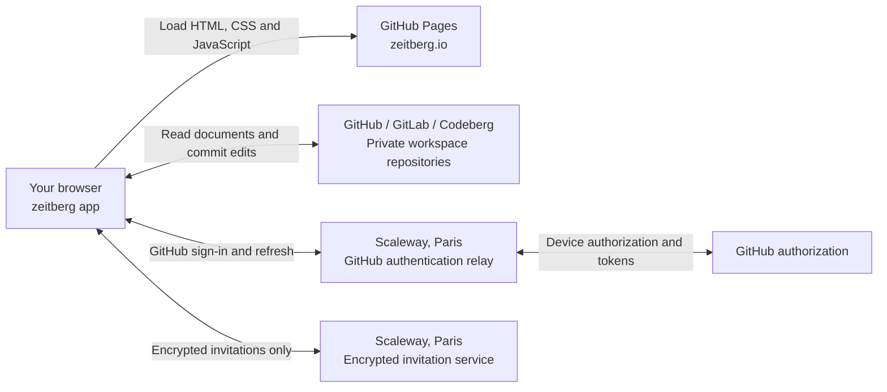
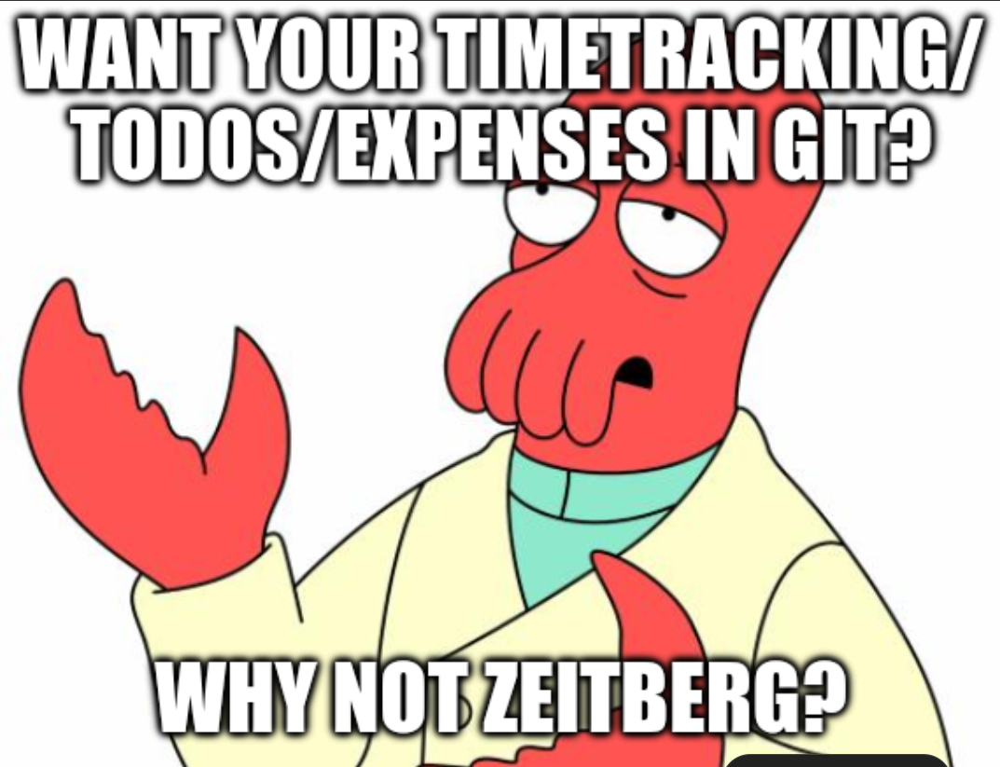

<p align="center">
  
</p>

<h1 align="center">zeitberg</h1>

<p align="center">
  <strong>Time · Tasks · Expenses → Git</strong><br />
  A static browser application whose data lives in your Git repository.
</p>

<p align="center">
  <a href="https://github.com/josephbirkner/zeitberg/actions/workflows/test.yml"></a>
  <a href="https://github.com/josephbirkner/zeitberg/actions/workflows/test.yml"></a>
  <a href="https://github.com/josephbirkner/zeitberg/releases/latest"></a>
</p>

---

zeitberg manages time, TODOs, and shared expenses. The application is plain HTML, CSS, and JavaScript, served by GitHub Pages. Workspace documents are not stored on a zeitberg server. Two small Scaleway services in Paris support GitHub sign-in and encrypted invitations; neither reads or writes workspace documents.

You choose a Git repository as the workspace. The browser reads and writes versioned documents directly through the provider API. The repository remains independently inspectable, cloneable, and portable.



GitLab and Codeberg OAuth runs directly in the browser. Workspace documents go directly to the Git provider, never through Scaleway. Invitation keys stay in the link fragment; the invitation service stores only ciphertext, expiring after 30 days.

## What it gives you

| Component | Today |
| --- | --- |
| **Time** | Responsive weekly timeline, keyboard and touch editing, search, billable totals, work-hour requirements, overtime accumulation, undo/redo, and manual or idle-triggered Git commits. |
| **TODOs** | Shared projects and sections, recurring tasks, filters, completion history, durable drafts, imports, and optional GitHub issue linkage. |
| **Expenses** | Exact multi-currency splits, reusable expense templates, participant balances, deterministic settlement suggestions, categories, shared project assignments, durable drafts, and atomic Git saves. |
| **Workspace** | A versioned root manifest, portable JSON documents, stable project identities, private Git history, direct browser-to-provider persistence, and English/German UI. |
| **Quality** | Bidirectional GitHub issue projects, deterministic unit tests, browser-level smoke tests, static type checking, and an enforced 90% production-logic line-coverage gate. |

The project is intentionally one application: time, tasks, and expenses share a project inventory and workspace identity while retaining separate documents and views.

## Similar projects

No direct equivalent surfaced in our review. The closest projects each overlap with one part of zeitberg:

- [GitJournal](https://github.com/GitJournal/GitJournal) stores Markdown notes in a Git repository of the user's choice.
- [TaskRepo](https://github.com/HenriquesLab/TaskRepo) stores tasks as Markdown files in Git repositories.
- [ActivityWatch](https://github.com/ActivityWatch/activitywatch) is an automated time tracker with user-controlled local data, but is not Git-backed.
- [Actual Budget](https://github.com/actualbudget/actual) is a local-first personal-finance application with its own synchronization model rather than Git storage.

## Workspace setup

For setup and usage instructions with fictional screenshots, read the user guide in [English](https://zeitberg.io/guide.html) or [German](https://zeitberg.io/guide.de.html) (locally: `guide.html` and `guide.de.html`). App help links follow the selected interface language; both static pages also have an explicit language switch. Both versions use the same English-interface screenshots, with translated captions and alternative text. Keep their chapter IDs and coverage aligned when editing.

GitHub, GitLab.com, Codeberg, and compatible CORS-enabled GitLab/Forgejo servers use the same workspace and save pipeline. GitHub supports device authorization when the deployment's authentication relay is configured, with PAT access retained under Custom connection. GitLab and Codeberg use direct browser Authorization Code + PKCE when their public client ids are configured.

1. Visit [zeitberg.io](https://zeitberg.io) and choose **Connect with GitHub**, **Codeberg**, or **GitLab**.
2. Review the provider's authorization request. GitHub also needs its App installed with access to the repositories you want to use.
3. Select one or more discovered workspaces and choose **Add selected workspaces**, or choose **Create workspace**. Name it, choose its apps, and confirm. New repositories are private; the app initializes the required files for you.
4. For a repository without a valid `zeitberg.json`, use the workspace editor to choose its shared name, timezone, projects path, and enabled components. Saving creates only missing component documents and preserves existing repository data.

Prefer a scoped token or your own server? Use **Custom connection** with an existing initialized private repository, its branch, and a token. GitHub PATs need `Contents: Read-only` to browse or `Contents: Read & write` to save; GitLab needs API access; Codeberg/Forgejo supports repository-scoped read/write tokens. Forgejo OAuth grants are broader than scoped PATs, as explained before authorization. Workspace links and QR codes are additional entry points, not separate storage models.

You may instead copy [`workspace-template`](./workspace-template) into the repository and edit `zeitberg.json` before connecting. Both onboarding paths use the same workspace model and canonical seed documents.

GitHub, GitLab.com, and Codeberg share the same canonical initialization builder, app selection, registry, and loading pipeline. GitHub creation targets the signed-in user's personal account and requires **Repository creation: Read and write**, not Administration. Install the GitHub App on that account and approve this permission; its repository access can remain scoped. Discovery automatically scans repository pages, marks existing connections, and allows filtering and multi-selection while scanning continues. The access link restarts discovery when you return, and **Refresh repositories** starts a fresh scan manually. A usable OAuth grant from an existing connection is reused for later scans and creation. If a Forgejo-family server blocks cross-origin requests, connection preflight reports that limitation instead of treating it as malformed data.

Creation uses the provider's returned default branch. Once created, the connection and grant are retained before initialization so an interrupted seed can be repaired by reconnecting. Repository POSTs are never automatically retried after a timeout: inspect or refresh the repository list before trying again.

A shell-based start looks like this after cloning this application repository:

```bash
mkdir zeitberg-data
cp -R workspace-template/. zeitberg-data/
cd zeitberg-data
git init
# Edit zeitberg.json before the first commit.
git add .
git commit -m "Initialize zeitberg workspace"
gh repo create YOUR_ACCOUNT/zeitberg-data --private --source=. --push
```

The token is kept in session storage by default. Selecting **Remember this token** opts into local storage. Repository requests go directly from the browser to the selected provider API; the static host never receives the credential. Related OAuth connections reference a shared grant so token refresh is coordinated. GitHub device authorization and refresh pass through the authentication relay; GitLab and Codeberg authorization remain direct.

After opening a workspace, use the first sidebar action beneath the zeitberg mark to manage connections. The browser keeps a registry of repository URL, branch, bootstrap path, verified workspace ID, and display name. PATs are connection-specific; OAuth connections can reference the same account grant. Switching repositories preserves unsaved drafts in a workspace-specific IndexedDB journal. Disconnecting one workspace does not log out or clear credentials for the others.

### Open workspaces and combined views

Connections load independently behind one progress screen. Failed connections are marked in workspace settings; healthy ones remain usable. Each module has its own workspace selection, while tasks and time-entry search can combine results across workspaces. Edits always save to their source repository.

Save / Ctrl+S saves pending changes across open workspaces. Autosave runs 60 seconds after the latest applied edit, undo, or redo. Writes are serialized per repository and acknowledge only the submitted snapshot, preserving edits made during a save. Unsaved drafts are isolated by workspace in IndexedDB.

Each workspace card offers a credential-free locator link or an encrypted invitation using a dedicated repository token. Invitations expire after 30 days; revocation prevents new imports, not access already imported. Revoke the underlying token to remove that access. OAuth account grants cannot be shared. Existing capability links remain supported, and ordinary navigation URLs never contain credentials.

See the [workspace guide](guide.html#workspaces) for switching, sharing, and QR codes, and the [saving guide](guide.html#save) for recovery. The [invitation service README](serverless/invitations/README.md) covers encryption and deployment. Interface language is a browser preference; workspace calendar calculations use the configured IANA timezone.

GitHub issue-linked projects additionally need Issues read/write access to their bound repository. Other workspaces do not need issue access.

## How the workspace works

`zeitberg.json` is the versioned bootstrap document. It declares:

- a stable workspace ID, name, and timezone;
- shared resources such as `data/projects.json`;
- enabled component types;
- repository-relative paths owned by each component.

The default template has this shape:

```text
zeitberg.json
data/
├── entries/                     # weekly files created as needed
├── index/entries-manifest.json
├── index/expenses-manifest.json
├── expenses.json
├── projects.json                # shared by time entries, TODOs, and expenses
├── todos.json
└── week-requirements.json
```

Time entries are normalized into ISO-week files. Their manifest records immutable Git blob SHAs, allowing IndexedDB to cache chunks safely without confusing an old revision for a new one.

The expense ledger stores money only as integer minor units with an explicit ISO currency. Exact payer contributions and owed allocations are authoritative; equal, percentage, and share rules are retained only as reproducible editing metadata. Its manifest hashes the precise ledger blob, and every save commits both files atomically.

TODOs, time entries, and expenses share the schema-v2 project/section taxonomy. Assignments use stable `project_key` and `section_key` values, so display names can change without rewriting historical records. Unsaved edits for all three components are journaled in IndexedDB; successful manual saves and autosaves clear acknowledged drafts while retaining newer edits. That journal protects against reloads but is not a substitute for a Git commit.

## Routes and browser history

The public root remains the landing and connection page. Initialized views use component-first routes:

- `/time` for the week timeline and Time search;
- `/todos` for tasks;
- `/expenses` for shared-expense ledgers and settlements.

The query string records the credential-free workspace locator and navigation state such as the selected week or TODO, filters, timeline zoom, and scroll time. PATs are never part of an ordinary route. Meaningful view changes create browser-history entries; high-frequency selection, filter, zoom, and scroll changes update the current entry. A small `404.html` handoff makes direct component-route reloads work on GitHub Pages without server-side rewrites.

## GitHub issue-linked TODOs

A workspace project can opt into GitHub issue persistence with an external reference:

```json
{
  "external_refs": [
    { "provider": "github", "id": "owner/repository" }
  ]
}
```

Sections may identify their repository-scoped issue label through a `github-label` external reference. At initialization and explicit refresh, zeitberg loads open and closed issues, filters out pull requests, maps recognized section labels, and conditionally revalidates an IndexedDB cache. GitHub remains authoritative for issue title, description, labels, and state; schema-v4 `todos.json` stores only small scheduling overlays for those tasks.

Edits remain local until a manual save or autosave. That operation creates, updates, closes, or reopens issues first and then commits the compact TODO document, with optimistic conflict checks preventing a newer upstream edit from being overwritten. Project settings provide repository inspection and explicit connect/detach migration choices, so existing local tasks are never bulk-published silently. Local-server mode continues to write workspace files without making remote issue changes.

## Local development

Keep the public application and private workspace as sibling checkouts:

```bash
cd /path/to/checkouts
gh repo clone josephbirkner/zeitberg
gh repo clone YOUR_ACCOUNT/zeitberg-data
cd zeitberg
npm ci
npm test
python3 server.py --workspace ../zeitberg-data
```

Open <http://127.0.0.1:8000/time?source=local>. When the sibling is named `zeitberg-data`, `--workspace` may be omitted.

Local mode serves application files from this checkout and maps workspace reads plus `POST /save` to the separate data checkout. It writes JSON without committing; review, commit, and push data changes from that repository independently.

To test the GitLab or Codeberg connection instead of a local workspace, run:

```bash
python3 server.py --no-local
```

Then open <http://127.0.0.1:8000/>. This serves the provider login flow, disables the local workspace endpoints, and restores component routes such as `/time` to `index.html`. A plain `python3 -m http.server` cannot perform that route fallback and will return a missing page after login or a component-route reload.

### Employer schedules, overtime and leave

The [time-tracking guide](guide.html#time) covers schedules, half-day leave, vacation planning, and overtime. Only billable entries count toward work totals; TOIL consumes overtime rather than vacation. Allowances are explicit and unused vacation carries forward.

Developer details: `work-time.js` owns daily accounting, `work-time.view.js` owns the editor, and `WeekRequirements` preserves legacy read compatibility. The configured `week_requirements` path uses [schema version 3](schema/work-requirements-v3.schema.json). Configuration saves immediately through the normal provider pipeline; Cancel discards the dialog draft. New workspaces have no employers or assumed vacation entitlement.

Legacy weekly documents remain readable. Historical conversion is a deliberate edit in the private data repository; preserve the original data in Git history and record uncertain mappings privately. Entry files do not need changing.

### Test coverage

Run the same quality gate used by GitHub Actions:

```bash
npm run coverage
```

The command runs every deterministic Node test under c8 and a headless Chromium smoke suite against `workspace-template`. Both layers run even if one fails. It prints statement, branch, function, and line coverage; enforces at least 90% aggregate line coverage; and writes an HTML report, LCOV data, and `coverage-summary.json` under the ignored `coverage/` directory. CI retains that directory as an artifact even when the gate fails.

The measured first-party production scope is explicit in `package.json`: `appstate.js`, `autosave.js`, `cache.js`, `config.js`, `datasource.js`, `demo.js`, `locale.js`, `model.js`, `oauth.js`, `routing.js`, `session-binding.js`, `store.js`, `utils.js`, `version.js`, and `work-time.js`. This includes domain models, persistence and cache behavior, provider adapters, autosave scheduling, workspace switching, disposable demo fixtures, build labels, localization, routing, and shared utilities. Tests, generated or vendored assets, and one-off repository/import/build scripts are outside the production metric.

Both `npm run test:browser` and `npm run coverage` also run the employer/leave dialog integration tests against a disposable workspace, including bulk edits, failed-save recovery, save/reload persistence, legacy-write protection and narrow layouts. They never write to your personal data repository.

The dialog regression suite checks desktop, 320px/390px mobile and short landscape layouts in light/dark themes and English/German. It covers centered close controls, clipping, sticky actions, expanded expense splits, inline validation, and preservation of optional task fields. Screenshots are written to a printed temporary directory. For Safari-engine checks, install WebKit with `npx playwright install webkit`, then run `node tests/dialogs.browser.mjs --webkit`.

The multi-workspace integration suite creates two disposable repositories with duplicate task and entry IDs. It exercises combined creation and history, origin-aware navigation, search scope restoration, delayed writes with newer edits in all three modules, failed-save recovery, idle autosave/reset/retry deadlines, close-page warnings, reduced-motion feedback, and narrow layouts. `workspace.sessions.js` and `workspace.todos.js` are browser-controller modules, tested through this real local HTTP workflow rather than included in the pure-logic Node coverage gate.

The DOM composition and browser-controller modules (`app.js`, `theme-init.js`, the `*.view.js` controllers, `workspace.js`, and `workspace.loader.js`) are excluded from the 90% Node/V8 gate because the application is served as unbundled browser modules under its production CSP. They are not hidden from measurement or automated validation: every coverage run launches the real static application in Chromium, records their separate line/function/branch execution in `coverage/browser-summary.json`, and checks local workspace initialization, component navigation, browser-history restoration, project/workspace/task/expense dialogs, and narrow full-screen layouts without credentials or private workspace data.

Repeat `--workspace` to test the multi-workspace switcher against several local repositories:

```bash
python3 server.py \
    --workspace ../zeitberg-data \
    --workspace ../zeitberg-shared-expenses
```

The server reads each repository's `workspace_id`, exposes only those explicitly selected roots, and keeps absolute filesystem paths out of browser routes. Local saves include the selected workspace ID so writes cannot cross into another exposed checkout.

### Stylesheet ownership

Styles are loaded explicitly from `styles/`: shared tokens, controls, application chrome, and dialogs belong in `common.css`; time tracking and time search belong in `time.css`; TODOs belong in `todos.css`; expenses belong in `expenses.css`; and the public site plus login belong in `landing.css`. Keep theme and responsive overrides beside the component they affect. New sub-apps should receive their own stylesheet instead of growing `common.css` by default.

Useful checks:

```bash
npm test
npm run typecheck
npm run check:data -- --workspace ../zeitberg-data
```

The one-way Todoist importer reads its token from `~/.todoist` and never copies it into a repository:

```bash
npm run import:todoist -- --workspace ../zeitberg-data
```

Use `--replace-todoist` to refresh an earlier import, `--active-only` to omit completed history, or `--completed-since YYYY-MM-DD` to choose an archive boundary.

## Hosting and provider authentication

### Playground and documentation screenshots

The front page’s **Try the playground** link opens `/time?demo=1`: a fictional workspace with time entries, employer requirements, tasks, projects, and shared expenses. Each reload or **Reset** discards edits and creates a fresh random scenario. Time covers the last 28 calendar days, ending today, with no entries beyond the current time. Workdays, weekends, full/half-day vacation, sickness and time in lieu produce matching activities and employer annotations; the following two weeks can also contain planned leave. Six shared projects, varied task priorities/due dates/completion/recurrence, and expenses with different payers and equal/weighted splits make the other modules explorable too.

Editing, undo/redo, and saving use the normal application pipeline, but documents and preferences stay in memory. The playground never reads your remembered repositories or credentials, opens IndexedDB, or writes to a Git provider or local workspace. **Exit demo** returns to the normal app. The banner remains visible to distinguish the playground from real data.

For a reproducible scenario, add an optional seed, for example `/time?demo=1&demoSeed=docs-v1`. It survives module navigation and reloads; without it, a fresh seed is generated in memory on each visit. Each date has its own seed-derived stream, so a fixed seed keeps already-completed days consistent as the rolling window advances. Reproducing the whole dataset also requires the same reference clock.

`npm run screenshots` extends the existing `tests/demo.browser.mjs` integration scenario: it starts an isolated server with local-workspace access disabled, sets the browser reference clock to September 15, 2026, uses seed `docs-v1`, and captures desktop/mobile examples under `test-results/demo/`. Locale (`en-US`), timezone (`Europe/Berlin`), dark theme, 100% app zoom, and desktop/phone viewports (1440×1000 / 390×844) are pinned. Captures wait for fonts and disable animations/carets. The pictured state is asserted before capture; `capture-manifest.json` records the settings, browser version, and image inventory. The same scenario runs in CI and rejects repository requests and durable-storage access. No private data or screenshots of personal workspaces are used.

To refresh the public guide images, run `npm run screenshots:publish`, inspect all six images in `assets/guide/`, and commit them with the UI change. They cover the week, daily leave, tasks, the task editor, expenses, and the expense editor. Publication happens only after the complete scenario passes. CI uploads `test-results/demo/` as a review artifact; it never commits screenshots automatically. The 1.4.0 guide images were refreshed from [this passing CI run](https://github.com/josephbirkner/zeitberg/actions/runs/41082834652), with the expense images updated from [the template/UI capture run](https://github.com/josephbirkner/zeitberg/actions/runs/41090790442). They were visually reviewed on October 30, 2026, using the fixed reference date above. The guide is plain static HTML, uses no credentials, and is included by the ordinary site builder.

Before a release, run `npm test`, `npm run typecheck`, `npm run screenshots`, and `npm run build:site` (with a fresh output directory). The guide test checks chapter links, local assets, screenshot alt text, and integration-scenario coverage; CI also checks that the built site contains the guide and screenshots. Open `guide.html` at desktop and phone widths and review the CI images before publishing changes. The mocked provider onboarding tests cover UI state and errors, not real provider authorization: record real GitHub/GitLab/Codeberg smoke checks separately, never as documentation screenshots containing credentials or private data.

### Build identity and Pages release setup

The landing-page footer displays the app version and served commit (plus a local-changes marker in development). `server.py` supplies checkout metadata; `npm run build:site` creates a new `dist/` artifact with embedded commit metadata and revision-specific cache keys. An unbuilt static checkout honestly says `unbuilt` rather than looking up an unrelated remote HEAD. The build refuses to overwrite an existing output directory; optionally supply a fresh path with `npm run build:site -- /path/to/new-directory`.

The public site uses **GitHub Actions** publishing through `.github/workflows/pages.yml`. A push to `main` builds and deploys only the staged static files, including matching build metadata; release branches do not deploy. Forks should select **Settings → Pages → Source → GitHub Actions**. The authentication and invitation functions are deployed separately; their source is excluded from the static artifact.

### Provider connections

The public deployment serves this repository from [zeitberg.io](https://zeitberg.io). You can also fork and host the same static files yourself, including from a private Pages deployment where your hosting plan supports one.

Provider connectors retain the same architecture:

- GitHub uses a fine-grained PAT or GitHub App user authorization, and GitHub's REST/GraphQL APIs.
- GitLab uses its REST API, one atomic multi-action commit per save, and [Authorization Code + PKCE](https://docs.gitlab.com/api/oauth2/) when configured.
- Codeberg/Forgejo uses its REST contents API and either a [scoped PAT](https://forgejo.org/docs/latest/user/token-scope/) or [public-client PKCE](https://forgejo.org/docs/latest/user/oauth2-provider/). Because Forgejo OAuth scopes are not fine-grained today, a repository-scoped PAT remains the least-privilege option.
- custom HTTPS hosts are explicitly trusted, probed for GitLab/Forgejo compatibility and usable only when their CORS policy permits direct browser requests.

To enable OAuth on a static deployment, register two public applications with these exact callback URLs:

```text
GitLab:   https://zeitberg.io/?oauth_provider=gitlab
Codeberg: https://zeitberg.io/?oauth_provider=codeberg
```

Enable Authorization Code with PKCE and do not place a client secret in this repository. Put the resulting public client ids into the `zeitberg-oauth-gitlab-client-id` and `zeitberg-oauth-codeberg-client-id` meta elements in [`index.html`](./index.html). Self-hosted deployments use their own origin in both callback URLs. The application validates short-lived session state, requires S256 PKCE, scrubs callback codes before token exchange, refreshes expiring grants, and loads no third-party runtime scripts.

The GitHub App's public client id is retained in the `zeitberg-oauth-github-client-id` meta element. Its device flow needs no client secret, but GitHub's device and token endpoints lack browser CORS support. A small [Scaleway relay](./serverless/github-auth/README.md) bridges only those authentication calls when `GITHUB_RELAY_URL` in `oauth.js` is configured. No callback URL is required for this device flow. User verification codes are displayed in the dialog; authorization happens on GitHub in another tab. Closing the dialog cancels polling. Grants are persisted only when a repository is connected, using the same session/remember choice and shared refresh pipeline as other providers. Workspace data never passes through the relay. GitLab and Codeberg keep their direct browser PKCE flows. GitHub repository creation uses the user grant directly against GitHub's API, outside the relay.

## License

Zeitberg is available under the [Apache License 2.0](./LICENSE).

## Credits and disclosure

The code for this project was written using large language models with extensive human supervision.

The zeitberg mark and landing landscape are original hand-authored SVGs. The mark's iOS and installable-web-app PNGs are reproducibly rasterized from [`assets/zeitberg-mark.svg`](./assets/zeitberg-mark.svg) by `npm run build:icons`. Interface icons use [Google Material Symbols](https://github.com/google/material-design-icons) under the [Apache License 2.0](./icons/LICENSE). The landing-page architecture graphic is an original SVG whose restrained visual language was informed by Kathryn Lavery's [Diagram Design](https://github.com/cathrynlavery/diagram-design) principles.

No generative or diffusion-based image model was used for the mark, landing landscape, or architecture graphic.

Provider logos retain their respective licenses and trademark ownership; see [provider asset credits](./assets/providers/LICENSE.txt).

<p align="center">
  <a href="https://imgflip.com/memegenerator/Futurama-Zoidberg">
    
  </a>
</p>

[`assets/why-not-zeitberg-2.png`](./assets/why-not-zeitberg-2.png) is a meme created from the [Futurama Zoidberg template on Imgflip](https://imgflip.com/memegenerator/Futurama-Zoidberg). The underlying Futurama and Dr. Zoidberg artwork is third-party material, remains the property of its respective rights holders, and is not covered by this repository's Apache License 2.0. zeitberg is an independent project and is not affiliated with Futurama or Dr. Zoidberg.
